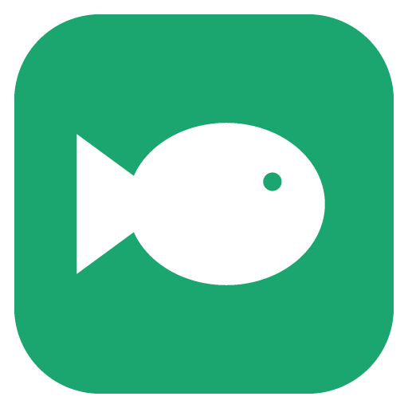
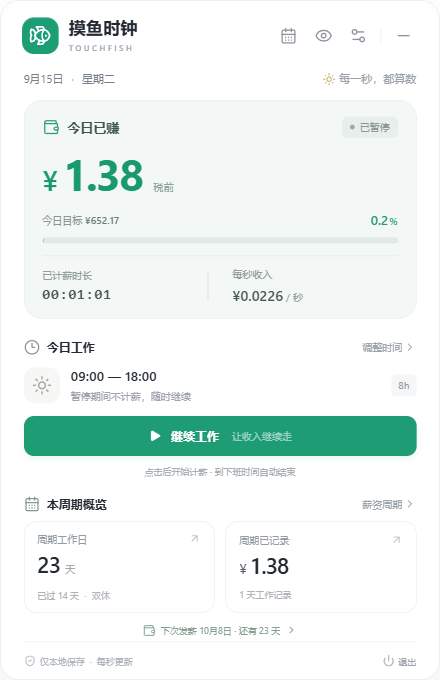
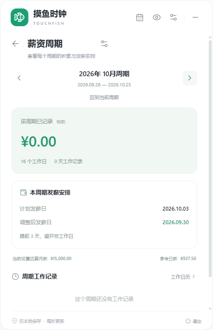
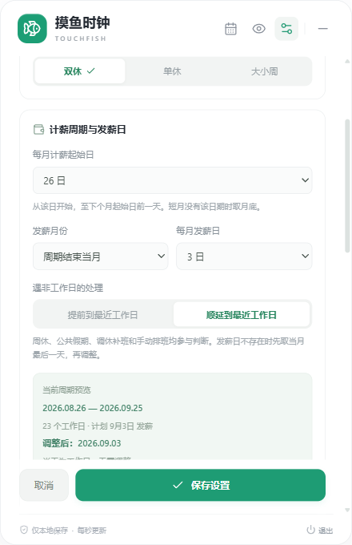

<p align="center">
  
</p>

<h1 align="center">TouchFish · 摸鱼时钟</h1>

<p align="center">
  一个安静待在系统托盘里的工资时钟，让每一秒的积累都看得见。
</p>

<p align="center">
  
  
  
  
  <a href="LICENSE"></a>
</p>

<p align="center">
  <a href="#features">功能特性</a> ·
  <a href="#preview">界面预览</a> ·
  <a href="#download">下载安装</a> ·
  <a href="#quick-start">快速开始</a> ·
  <a href="#development">本地开发</a>
</p>

---

TouchFish 是一款常驻系统托盘的桌面应用。点击托盘图标即可查看今日工作进度、按秒累计的税前收入，以及下次发薪倒计时。界面采用圆角卡片设计，支持自定义工作制、休息时段、计薪周期和发薪安排；设置与工作记录保存在本机，无需登录。

<a id="features"></a>

## 功能特性

| 功能           | 说明                                                                         |
| -------------- | ---------------------------------------------------------------------------- |
| 秒级工资时钟   | 手动开始、暂停和继续工作，实时查看计薪时长、收入与进度；到下班时间自动停止   |
| 灵活排班       | 支持双休、单休、大小周，可按星期分别设置上下班时间                           |
| 午休与晚饭     | 两段休息均可修改或关闭；只扣除工作时段内的交集，重叠部分不会重复扣除         |
| 公共假期与调休 | 内置中国大陆 2026、2027 年官方放假及补班安排，支持在日历中手动覆盖           |
| 月度计薪周期   | 支持每月 1–31 日起算，例如 26 日至次月 25 日，按周期汇总工作日和收入         |
| 发薪日管理     | 可设为周期结束当月、次月或隔月；遇非工作日，选择提前或顺延至最近的工作日     |
| 周期记录       | 浏览前后各期的工作记录、计划发薪日和调整后日期，首页显示下次发薪倒计时       |
| 应用更新       | 在设置中检查新版、下载更新包；检查与下载均使用系统代理配置，并校验文件完整性 |
| 托盘与隐私     | 点击面板外部即可收起，后台继续记录；支持隐藏金额与本地数据备份               |

<a id="preview"></a>

## 界面预览

<table>
  <tr>
    <th align="center">今日概览</th>
    <th align="center">薪资周期</th>
    <th align="center">发薪设置</th>
  </tr>
  <tr>
    <td align="center"></td>
    <td align="center"></td>
    <td align="center"></td>
  </tr>
</table>

截图使用演示数据。更多界面：[午休与晚饭设置](docs/dinner-settings.png) · [公共假期日历](docs/holiday-calendar.png)。

<a id="download"></a>

## 下载安装

| 平台    | 安装包格式                         | 当前验证情况                   |
| ------- | ---------------------------------- | ------------------------------ |
| Windows | 安装版 `.exe`、免安装便携版 `.exe` | 已完成实际运行与桌面流程验证   |
| macOS   | `.dmg`                             | 已配置构建，待目标系统实际验证 |
| Linux   | `.AppImage`                        | 已配置构建，待目标系统实际验证 |

前往 [GitHub Releases](https://github.com/TedGillXD/TouchFish/releases/latest) 下载正式版本。Windows 提供安装版与便携版，macOS 提供 Intel 与 Apple silicon 安装包，Linux 提供 AppImage。各版本同时附带校验文件。

仓库提供源码与[三平台构建发布工作流](.github/workflows/release.yml)。所有平台构建与检查成功后，工作流将安装包和校验文件发布到同一个 Release；开发构建附件也可在 [GitHub Actions](https://github.com/TedGillXD/TouchFish/actions/workflows/release.yml) 中查看。

### 应用内更新

打开「设置 → 应用更新」，点击「检查更新」。发现稳定版本后可查看下载进度，下载完成并通过完整性校验后，再选择安装。检查新版、读取更新清单以及下载安装包均使用 Electron 的原生网络栈，跟随**系统代理设置（含 PAC / WPAD）**；切换代理后可直接重试，无需在应用中填写代理账号或密码。

- Windows 安装版和 Linux AppImage 支持下载后重启安装；安装前会先保存已排队的工作记录。
- 便携版或其他不支持原位安装的运行方式会打开已校验的安装包，由用户完成安装。
- macOS 当前发布包未配置开发者签名与公证，因此使用已校验的 DMG 完成更新：打开后将新版应用拖入「应用程序」，覆盖旧版。
- 请先保存正在编辑的设置。网络、代理身份验证或文件校验失败时，应用会显示可重试的错误，校验失败的文件不会进入安装。

1.3.0 是首个包含应用内更新入口的版本；更旧版本需先从 Releases 手动下载一次。更新保留本地设置与计薪记录。

<a id="quick-start"></a>

## 快速开始

1. 启动应用，点击系统托盘图标打开面板。Windows 位于任务栏通知区域，macOS 位于菜单栏，Linux 位置取决于桌面环境。
2. 打开右上角「设置」，填写税前月薪，选择工作制，并设置每周的上下班时间。
3. 按需调整午休与晚饭时段。晚饭默认 **18:00–19:00**，可修改或关闭。
4. 配置计薪周期与发薪日；在「工作日历」中核对公司实际的放假、补班安排。
5. 点击「开始工作」。暂停、午休和晚饭期间不计薪，到下班时间自动结束；隔日需要重新开始。
6. 在「薪资周期」中切换前后周期，查看工作记录及发薪安排。

点击面板外部会收起窗口，计时仍在后台运行。通过托盘右键菜单或面板底部「退出」关闭应用。升级时先退出旧版，再启动新版。

<a id="payroll"></a>

## 计薪周期与发薪规则

默认计薪周期为每月 **1 日至月底**，**次月 15 日**发薪，遇非工作日提前至最近的工作日。

| 设置       | 规则                                                                                   |
| ---------- | -------------------------------------------------------------------------------------- |
| 计薪起始日 | 每月 1–31 日，结束于下个周期起始日前一天；短月没有指定日期时取月底，各周期连续且不重叠 |
| 发薪月份   | 以**周期结束月份**为基准，选择当月、次月或隔月                                         |
| 每月发薪日 | 1–31 日；当月没有该日期时，先取该月最后一天，再应用工作日调整                          |
| 提前发薪   | 仅向前寻找最近的工作日，允许跨月、跨年                                                 |
| 顺延发薪   | 仅向后寻找最近的工作日，允许跨月、跨年                                                 |

例如，计薪周期为 **10 月 26 日至 11 月 25 日**，选择“周期结束次月 15 日”时，计划发薪日为 **12 月 15 日**。选择当月发薪时，日期可能早于周期结束，属于预发安排。

发薪日调整复用所选工作日历，包含工作制、公共假期、调休补班和手动排班；所选方向 366 天内均没有可用工作日时，会提示无法确定。首页「下次发薪」取调整后最近的日期，可能对应上一计薪周期，倒计时按自然日计算。

发薪安排用于记录计划，不表示工资已经到账，也不会执行转账。

<a id="calculation"></a>

## 工资如何计算

```text
当日参考工资 = 税前月薪 ÷ 所属计薪周期的计划工作日数
每秒工资     = 当日参考工资 ÷ 当天计划计薪秒数
已记录收入   = 每秒工资 × 实际记录的计薪秒数
```

- 计划计薪时长扣除启用的午休、晚饭与工作时段的交集；两段休息重叠时只扣除一次。
- 只有点击开始后实际记录的时长会累计。上班前、下班后、暂停和休息期间不累计，每日累计不超过当天计划计薪时间。
- 当天首次开始时保存工资与排班快照，之后修改设置不会追溯改变已开始记录的单价与规则。更改周期后，汇总按新的日期范围展示，原记录金额保留。
- 旧版记录保留原自然月计薪标准；没有晚饭时段的旧记录不会补扣晚饭时间。
- 暂不支持跨夜班次。金额为个人设置下的税前进度估算，不涉及个税、社保、加班费或正式工资结算。

### 公共假期

工作日判断优先级为：**手动排班 > 已启用的官方放假、补班安排 > 双休 / 单休 / 大小周**。官方假期不计为工作日，调休补班计入，同一天不会重复统计。

当前内置中国大陆 **2026、2027 年**数据，离线可用，**不会自动联网更新**。未收录年份会提示，暂按工作制与手动排班计算；其他地区的公共假期也可手动调整。月历按自然月显示。

数据依据国务院办公厅公布的 [2026 年放假调休通知](https://www.beijing.gov.cn/zhengce/zhengcefagui/202511/t20251104_4258873.html)与 [2027 年放假调休通知](https://chinajob.mohrss.gov.cn/h5/c/2026-11-09/635850.shtml)整理。

<a id="development"></a>

## 本地开发

需要 **Node.js 22.12 或更新版本**、npm 和桌面图形环境。

```sh
git clone https://github.com/TedGillXD/TouchFish.git
cd TouchFish
npm ci
npm run dev
```

| 命令                   | 用途                                     |
| ---------------------- | ---------------------------------------- |
| `npm run dev`          | 启动桌面开发环境                         |
| `npm run dev:web`      | 启动界面开发预览                         |
| `npm test`             | 检查工资、排班、假期与计薪周期等核心逻辑 |
| `npm run typecheck`    | 执行 TypeScript 类型检查                 |
| `npm run build`        | 构建界面与 Electron 主进程               |
| `npm run test:desktop` | 使用隔离数据运行真实桌面流程检查         |
| `npm start`            | 启动已构建的桌面应用                     |

项目使用 **Electron + React + TypeScript + Vite**。核心测试覆盖短月与闰年、大小周、休息时段、跨月周期、长假调整、历史记录迁移及夏令时日期计算。

<a id="build"></a>

## 构建与打包

在对应系统中执行：

```sh
# Windows
npm run dist:win

# macOS
npm run dist:mac

# Linux
npm run dist:linux
```

产物输出至 `release/`，Windows 文件名分别为：

```text
TouchFish-<版本>-win-<架构>-setup.exe
TouchFish-<版本>-win-<架构>-portable.exe
```

[GitHub Actions 工作流](.github/workflows/release.yml)支持手动触发、推送 `v*` 标签触发，以及 `main` 上版本或发布配置变化时触发。工作流分别在 Windows、macOS 和 Linux 上检查并构建，核对安装包、更新元数据及校验值后，才会将草稿 Release 发布为正式版本；已经发布的相同版本会跳过。当前配置不包含发行签名或 macOS 公证。

Linux 托盘可用性取决于桌面环境，部分 GNOME 环境需要 AppIndicator 扩展。macOS 与 Linux 的实际桌面行为仍需在目标系统验证。

<a id="data"></a>

## 数据与隐私

应用无需登录，设置与工作记录保存在本机 Electron 用户数据目录中：

| 系统    | 常见目录                                                       |
| ------- | -------------------------------------------------------------- |
| Windows | `%APPDATA%/摸鱼时钟/`                                          |
| macOS   | `~/Library/Application Support/摸鱼时钟/`                      |
| Linux   | `$XDG_CONFIG_HOME/摸鱼时钟/`，未设置时为 `~/.config/摸鱼时钟/` |

- `state.json`：当前设置与计时记录。
- `state.backup.json`：上一份有效数据。

实际位置由 Electron 与运行方式决定。备份或迁移前先退出应用，再复制整个用户数据目录。测试可用 `TOUCHFISH_USER_DATA` 指定独立目录；使用 `--hidden` 启动可直接常驻托盘。

<a id="contributing"></a>

## 参与贡献

欢迎通过 [Issues](https://github.com/TedGillXD/TouchFish/issues) 报告问题或建议，也欢迎提交 Pull Request。提交问题时请附上系统版本、应用版本和复现步骤；截图与日志中请隐藏个人薪资信息。

提交代码前，建议运行 `npm test`、`npm run typecheck`；涉及界面、托盘或记录持久化时，同时检查对应的桌面流程。

<a id="license"></a>

## 开源许可

本项目采用 [MIT License](LICENSE)。
