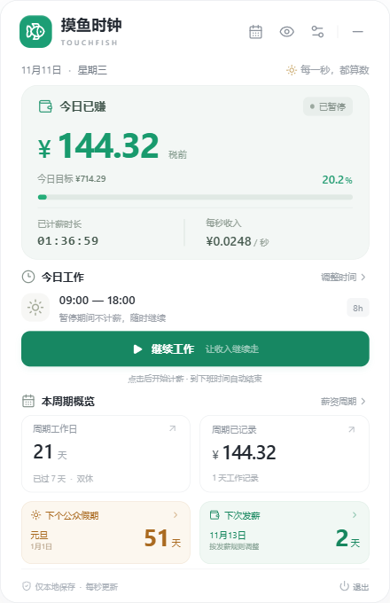
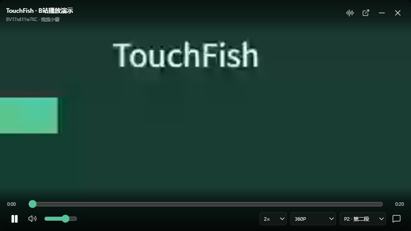
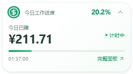
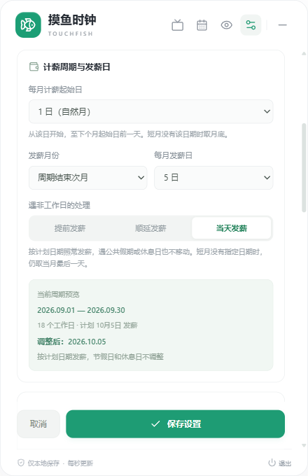
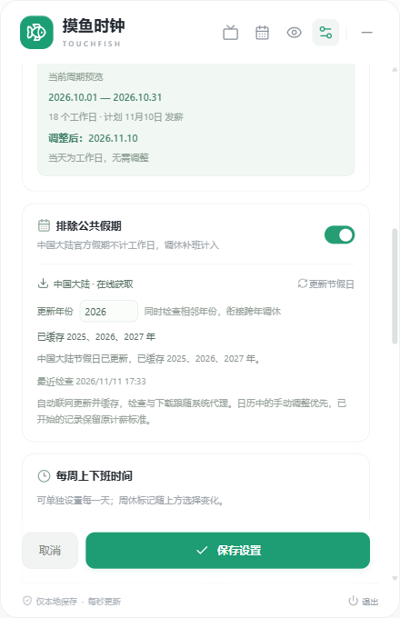

<p align="center">
  
</p>

<h1 align="center">TouchFish · 摸鱼时钟</h1>

<p align="center">
  一个安静待在系统托盘里的工资时钟，让每一秒的积累都看得见。
</p>

<p align="center">
  
  
  
  
  <a href="LICENSE"></a>
</p>

<p align="center">
  <a href="#features">功能特性</a> ·
  <a href="#preview">界面预览</a> ·
  <a href="#download">下载安装</a> ·
  <a href="#quick-start">快速开始</a> ·
  <a href="#bilibili">B站小窗</a> ·
  <a href="#youtube">YouTube</a> ·
  <a href="#boss-key">老板键</a> ·
  <a href="#data">数据备份</a> ·
  <a href="#development">本地开发</a>
</p>

---

TouchFish 是一款常驻系统托盘的桌面应用。点击托盘图标即可查看今日工作进度、按秒累计的税前收入，以及下次发薪倒计时。界面采用圆角卡片设计，支持自定义工作制、休息时段、计薪周期和发薪安排，也可在独立小窗中听、看 B 站视频。工资时钟无需登录，设置与工作记录保存在本机。

<a id="features"></a>

## 功能特性

| 功能           | 说明                                                                         |
| -------------- | ---------------------------------------------------------------------------- |
| 秒级工资时钟   | 点击即开始，按剩余有效秒数分摊日目标；支持暂停、继续，结束时补齐当天目标金额   |
| 灵活排班       | 支持双休、单休、大小周，休息日可自选，例如周一、周二；按星期分别设置工时     |
| 午休与晚饭     | 两段休息均可修改或关闭；只扣除工作时段内的交集，重叠部分不会重复扣除         |
| 公共假期与调休 | 自动获取中国大陆放假及调休补班安排，本地缓存离线可用，支持手动覆盖           |
| 月度计薪周期   | 支持每月 1–31 日起算，例如 26 日至次月 25 日，按周期汇总工作日和收入         |
| 发薪日管理     | 可设为周期结束当月、次月或隔月；遇非工作日，可提前、顺延或当天照常发薪       |
| 周期记录       | 浏览前后各期的工作记录、计划发薪日和调整后日期，首页显示下次发薪倒计时       |
| 假期与发薪倒计时 | 重点色显示距下一个公众假期和调整后发薪日的自然日天数；支持直达对应日历和薪资周期 |
| 应用更新       | 在设置中检查新版、下载更新包；检查与下载均使用系统代理配置，并校验文件完整性 |
| 托盘与隐私     | 点击面板外部即可收起，后台继续记录；支持隐藏金额与本地数据备份               |
| Windows 悬浮窗 | 置顶显示今日计薪进度，展开查看收入、时长与状态；支持拖动、记住位置、隐藏金额及 B 站播放／暂停 |
| B站摸鱼小窗 | 扫码登录后输入 BV 号听、看视频；无边框小窗可缩放、不置顶，鼠标移入显示播放控制 |
| B站历史记录 | 自动保留搜索与播放过的 BV 号，点击再次查找；支持单条删除、确认清空及重启保留 |
| 播放与弹幕 | 支持分 P、进度、倍速、可用清晰度、音量和弹幕开关；听视频时仅保留音频流 |
| YouTube 配套扩展（实验性） | 提供 Chrome / Edge 专属窗口连接入口，需手动加载配套扩展；真实浏览器登录与播放仍待验收 |
| 老板键 | 全局快捷键暂停摸鱼媒体并收起相关窗口，工资继续计时；可自定义快捷键，恢复窗口后保持暂停 |
| 数据备份与 Git 同步 | 导出 JSON、预览导入并保留恢复副本；可连接个人私有 Git 仓库，手动上传与下载备份 |

**1.6.0** 新增数据管理：通过原生文件对话框导出 JSON、预览并恢复备份，支持旧版 `state.json`，可选择是否恢复悬浮窗与老板键偏好。恢复前自动保存本机恢复副本，校验失败不修改数据，写入失败时尝试回退；导出不中断计薪，恢复不会继续累计另一台设备的离线时长。个人 Git 备份支持 HTTPS／SSH 私有仓库，沿用系统 Git 身份，手动检查、上传和下载，远端并发变化时停止覆盖。升级保留现有 1.x 设置与记录，YouTube 继续作为实验性入口提供。

**1.5.3** 新增 B 站搜索与播放历史：按 BV 号去重、本机持久保存，支持重新查找、单条删除和确认清空；删除后不会被迟到请求或播放器自动刷新重新加回。同时新增可配置的全局老板键，一键暂停摸鱼媒体并收起相关窗口，工资继续计时，恢复窗口后保持暂停。YouTube 配套扩展随包提供实验入口，需手动加载扩展，真实浏览器登录与播放仍待验收。

**1.5.2** 为 Windows 悬浮窗增加 B 站播放／暂停控制，视频和听音频均可使用，最小化播放器后也能操作；同时修复 B 站新版扫码地址被误拒绝的问题。

**1.5.1** 修正计薪规则：点击开始立即计薪，按当前至下班的有效秒数分摊日目标；下班或手动结束时补齐该日目标，保留真实计薪时长，并兼容旧版已结束、暂停和等待上班的记录。

**1.5.0** 新增 B 站摸鱼入口，并包含假期与发薪双倒计时、三种发薪策略和自定义周休。公众假期倒计时独立于公司的计薪排班；没有可用节假日数据时提示更新，假期当天显示「假期中」，发薪当天显示「今天发薪」。

<p align="center"></p>

<a id="preview"></a>

## 界面预览

<table>
  <tr>
    <th align="center">今日概览</th>
    <th align="center">薪资周期</th>
    <th align="center">发薪设置</th>
  </tr>
  <tr>
    <td align="center"></td>
    <td align="center"></td>
    <td align="center"></td>
  </tr>
</table>

截图使用演示数据。更多界面：[午休与晚饭设置](docs/dinner-settings.png) · [公共假期日历](docs/holiday-calendar.png)。

<table>
  <tr><th align="center">B站摸鱼入口</th><th align="center">可缩放播放小窗</th></tr>
  <tr>
    <td align="center"></td>
    <td align="center"></td>
  </tr>
</table>

<a id="download"></a>

## 下载安装

| 平台    | 安装包格式                         | 当前验证情况                   |
| ------- | ---------------------------------- | ------------------------------ |
| Windows | 安装版 `.exe`、免安装便携版 `.exe` | 已完成实际运行与桌面流程验证   |
| macOS   | `.dmg`                             | 已配置构建，待目标系统实际验证 |
| Linux   | `.AppImage`                        | 已配置构建，待目标系统实际验证 |

前往 [GitHub Releases](https://github.com/TedGillXD/TouchFish/releases/latest) 下载正式版本。Windows 提供安装版与便携版，macOS 提供 Intel 与 Apple silicon 安装包，Linux 提供 AppImage。各版本同时附带校验文件。

仓库提供源码与[三平台构建发布工作流](.github/workflows/release.yml)。所有平台构建与检查成功后，工作流将安装包和校验文件发布到同一个 Release；开发构建附件也可在 [GitHub Actions](https://github.com/TedGillXD/TouchFish/actions/workflows/release.yml) 中查看。

### 应用内更新

打开「设置 → 应用更新」，点击「检查更新」。发现稳定版本后可查看下载进度，下载完成并通过完整性校验后，再选择安装。检查新版、读取更新清单以及下载安装包均使用 Electron 的原生网络栈，跟随**系统代理设置（含 PAC / WPAD）**；切换代理后可直接重试，无需在应用中填写代理账号或密码。

从 1.3.1 起，检查新版直接读取 GitHub Releases 中的公开更新清单，避免依赖匿名 REST API 配额；共享代理出口的 API 额度耗尽时，仍可通过 Release 文件检查和下载更新。

- Windows 安装版和 Linux AppImage 支持下载后重启安装；安装前会先保存已排队的工作记录。
- 便携版或其他不支持原位安装的运行方式会打开已校验的安装包，由用户完成安装。
- macOS 当前发布包未配置开发者签名与公证，因此使用已校验的 DMG 完成更新：打开后将新版应用拖入「应用程序」，覆盖旧版。
- 请先保存正在编辑的设置。网络、代理身份验证或文件校验失败时，应用会显示可重试的错误，校验失败的文件不会进入安装。

1.3.0 是首个包含应用内更新入口的版本；更旧版本需先从 Releases 手动下载一次。更新保留本地设置与计薪记录。

已安装 1.3.0 的用户若遇匿名 API 限流，可从 Releases 手动升级至 1.3.1 或更新版本。

<a id="quick-start"></a>

## 快速开始

1. 启动应用，点击系统托盘图标打开面板。Windows 位于任务栏通知区域，macOS 位于菜单栏，Linux 位置取决于桌面环境。
2. 打开右上角「设置」，填写税前月薪，选择工作制，并设置每周的上下班时间。
3. 按需调整午休与晚饭时段。晚饭默认 **18:00–19:00**，可修改或关闭。
4. 配置计薪周期与发薪日；在「工作日历」中核对公司实际的放假、补班安排。
5. 点击「开始工作」后立即计薪，按当前时刻至设定下班时间的有效秒数分摊日目标。暂停、午休和晚饭期间不计时，结束时补齐当天目标金额；隔日需要重新开始。
6. 在「薪资周期」中切换前后周期，查看工作记录及发薪安排。

点击面板外部会收起窗口，计时仍在后台运行。通过托盘右键菜单或面板底部「退出」关闭应用。升级时先退出旧版，再启动新版。

### Windows 悬浮窗

Windows 版默认显示一个绿白色的圆角悬浮窗，收起时只显示今日计薪进度；点击箭头展开，即可查看今日税前收入、已计薪时长和当前状态。暂停、午休、晚饭和下班后的数字与完整面板保持一致。

<p>
  
  
  
</p>

- 拖动非按钮区域可调整位置，重启后会记住位置；显示器变化时会将窗口移回可见工作区。
- 点击悬浮窗的图标或「打开完整面板」，可返回主界面开始、暂停或结束工作。
- 打开 B 站视频或音频后，悬浮窗出现播放／暂停按钮，收起和展开状态均可使用；它只控制媒体播放，不会暂停工资计时。播放器最小化时也可控制，操作不会把小窗强行弹回。关闭播放器后按钮自动隐藏，悬浮窗恢复原宽度。
- 在主面板隐藏金额后，悬浮窗同步隐藏金额；隐私状态会在重启后保留。
- 右键点击悬浮窗图标，可展开或收起、隐藏金额、重置位置或隐藏悬浮窗；也可在「偏好设置」或托盘右键菜单中切换显示。隐藏悬浮窗后，后台计时仍继续。

悬浮窗仅在 Windows 提供，macOS 与 Linux 继续使用系统托盘面板。

<a id="bilibili"></a>

### B站摸鱼小窗

1.5.2 已兼容 B 站新的 `account.bilibili.com` 扫码地址，并保留旧版扫码地址兼容。

点击主面板右上角的「摸鱼」进入 B 站面板。可以先匿名查看公开视频，也可点击「获取二维码」，使用 B 站 App 扫码并在手机确认登录；二维码过期后可重新获取。登录状态保存在本机，点击「退出登录」会清除应用的 B 站登录凭据。

1. 输入 `BV` 号或完整的 B 站视频链接，点击查找。多分 P 视频可先选择要播放的部分。
2. 点击「听视频」仅播放音频，或点击「看视频」打开视频小窗；播放中可随时切换模式。
3. 拖动小窗顶部调整位置，拖动窗口边缘调整大小。小窗不置顶，其他应用窗口可以覆盖它。
4. 鼠标移入小窗时显示控制：播放/暂停、进度、音量、倍速、可用清晰度、分 P、弹幕、最小化和关闭。鼠标移出后收起；键盘聚焦控制时仍保持可见。

视频区域按空格播放或暂停，左右方向键快退或快进 5 秒，按 `Esc` 关闭小窗。最小化小窗可以继续听音频，关闭小窗会停止播放。收起主面板不会中断小窗。

#### 搜索与播放记录

从 **1.5.3** 起，应用在本机保留有效 BV 号的搜索记录，无需登录，也无需先播放；暂时无法读取的视频仍保留 BV 号，方便稍后重试。查询成功后补充标题、UP 主和时长；打开音频或视频后更新最近播放时间、模式与分 P。同一 BV 号合并为一条，按最近搜索或播放时间排列，不自动过期。

在 B 站面板的「历史记录」中点击条目可再次查找，并回填上次播放的分 P，由你选择听或看，不会自动播放。可删除单条记录，或点击「清空记录」并确认后删除全部；删除后重启仍保持删除，不会因较早的查询或播放请求随后返回而重新出现。删除历史不会停止当前播放。

清晰度和可播放内容取决于 B 站接口返回、登录状态及账号权限；受限、下架或暂时失效的视频会提示重试，也可直接打开原站。应用不会绕过会员、地区或内容访问限制。视频与音频通过 Electron 原生网络流式播放，跟随系统代理，不会保存为下载文件；弹幕为只读显示。

<a id="youtube"></a>

### YouTube 配套扩展（实验性）

1.5.3 随包提供实验性入口，需要手动加载配套扩展；真实 Chrome / Edge 账号登录与 YouTube 网络播放尚未完成实机验收。该方案通过你正常使用的 **Chrome 或 Edge 用户配置**打开 YouTube，沿用浏览器里的 Google 登录状态与网络配置。摸鱼时钟通过配套扩展创建和控制专属播放窗口，应用不读取或复制账号 Cookie、密码。

1. 在 Chrome 打开 `chrome://extensions`，或在 Edge 打开 `edge://extensions`，开启「开发者模式」。
2. 在摸鱼面板切换到「YouTube」，点击「打开扩展目录」。在浏览器选择「加载已解压的扩展程序」，选择打开的整个 `youtube-companion` 文件夹。源码目录是 [extensions/youtube-companion](extensions/youtube-companion)；打包时扩展会随应用放入 `resources/youtube-companion`，面板按钮可直接定位。
3. 在面板选择已经加载扩展的 Chrome 或 Edge，点击「连接浏览器」。浏览器会打开本机 `127.0.0.1` 配对页，在该页点击「连接此浏览器」。应用显示「已连接」后即可播放。**每次应用启动后需重新连接**，更换浏览器用户配置或重启浏览器后也可重新配对。
4. 输入 YouTube 视频链接或 11 位视频 ID，点击「播放」。需要登录时点击「在专属窗口打开 YouTube / 登录」，在真实浏览器中按 Google 页面提示完成登录、验证，再回到应用播放。

播放使用 YouTube 原站页面。可在应用中调整音量、倍速，用 Windows 悬浮窗暂停或继续；画质、字幕等设置在原站播放器中操作。专属窗口可以最小化继续听音频，窗口外观由浏览器提供，不承诺 B 站播放器那样的无边框样式。视频是否可播放仍取决于当前浏览器网络、账号和内容状态。

应用更新后，请在浏览器扩展管理页重新加载配套扩展，再连接应用。

扩展只控制摸鱼时钟创建的专属窗口，不操作已有工作标签页。请保持专属播放窗口独立；若把其他工作标签页拖入其中，扩展会避免最小化整个混合窗口。配对连接只在本机使用，应用与扩展断开时会尽量暂停并收起受管窗口。更多安装细节见[配套扩展说明](extensions/youtube-companion/README.md)。

<a id="boss-key"></a>

### 老板键

从 **1.5.3** 起提供老板键。默认快捷键为 **Windows / Linux：`Ctrl + Alt + B`，macOS：`⌘ + ⌥ + B`**，应用未聚焦时也可触发已注册的全局快捷键。

- 按下老板键会暂停 B 站和专属 YouTube 窗口的媒体，并收起主面板、Windows 工资悬浮窗及相关播放窗口；工资计时继续运行。
- 重复按键保持收起状态。通过托盘菜单「恢复摸鱼窗口（保持暂停）」或「偏好设置 → 老板键」恢复窗口后，媒体保持暂停，由你手动继续播放。
- 在「偏好设置 → 老板键」点击快捷键输入框，按下所需组合键或功能键，再点击「保存快捷键」，立即生效。快捷键冲突或保存失败会显示错误，原来可用的快捷键保持不变；也可点击「恢复默认」。

老板键覆盖本应用窗口和配套扩展管理的专属 YouTube 窗口，不会收起其他工作浏览器标签。macOS 首次使用若出现系统权限提示，请按系统设置允许；Linux 全局快捷键的可用性取决于桌面环境和门户支持，以设置页的注册状态为准。

<a id="payroll"></a>

## 计薪周期与发薪规则

默认计薪周期为每月 **1 日至月底**，**次月 15 日**发薪，遇非工作日提前至最近的工作日。

在「偏好设置 → 薪资与工作制」中可标记每周的休息日：双休选择任意两个不同星期，单休选择一天；大小周分别使用双休周的两天与单休周的一天，按基准周交替。例如服务业可设置 **周一、周二休息，周六、周日上班**。上下班时间表会显示周休标记，月历、周期工作日、参考日薪和发薪调整同步使用该安排。旧配置的工作制和单休选择保持不变，未配置双休日时默认周六、周日；已有工作记录保留原计薪快照。

<p align="center"></p>

| 设置       | 规则                                                                                   |
| ---------- | -------------------------------------------------------------------------------------- |
| 计薪起始日 | 每月 1–31 日，结束于下个周期起始日前一天；短月没有指定日期时取月底，各周期连续且不重叠 |
| 发薪月份   | 以**周期结束月份**为基准，选择当月、次月或隔月                                         |
| 每月发薪日 | 1–31 日；当月没有该日期时，先取该月最后一天，再应用所选处理规则                          |
| 提前发薪   | 仅向前寻找最近的工作日，允许跨月、跨年                                                 |
| 顺延发薪   | 仅向后寻找最近的工作日，允许跨月、跨年                                                 |
| 当天发薪   | 保留计划发薪日期，遇公共假期或每周休息日均不移动；短月仍先取该月最后一天             |

例如，计薪周期为 **10 月 26 日至 11 月 25 日**，选择“周期结束次月 15 日”时，计划发薪日为 **12 月 15 日**。选择当月发薪时，日期可能早于周期结束，属于预发安排。

选择提前或顺延时，发薪日调整复用所选工作日历，包含自定义周休、公共假期、调休补班和手动排班；所选方向 366 天内均没有可用工作日时，会提示无法确定。选择「当天发薪」则保留计划日期，例如国庆假期中的 10 月 5 日仍显示为 10 月 5 日。首页「下次发薪」使用所选规则处理后的最近日期，可能对应上一计薪周期，倒计时按自然日计算。

<p align="center"></p>

发薪安排用于记录计划，不表示工资已经到账，也不会执行转账。

<a id="calculation"></a>

## 工资如何计算

**1.5.1** 起采用以下计薪规则。

```text
当日日目标   = 税前月薪 ÷ 所属计薪周期的计划工作日数
有效计薪秒数 = 首次点击开始至设定下班时间的秒数 − 期间启用的午休、晚饭秒数
每秒工资     = 当日日目标 ÷ 有效计薪秒数
计时中的收入 = 每秒工资 × 实际记录的计薪秒数（不超过日目标）
结束后的收入 = 当日日目标
```

- 点击开始就以当前时刻为计薪起点，无需等待设置中的上班时间；晚开始也会按当天剩余有效秒数分摊完整日目标。
- 午休、晚饭只扣除与本次计薪起点至下班时段的交集，两段休息重叠时只扣除一次。若剩余时间全部为休息，秒薪为零，到下班时仍结算日目标。
- 暂停期间不增加时长和金额；继续工作时沿用当天首次开始锁定的秒薪，已经累计的收入与时长保留。
- 到设定下班时间会自动结束并补齐日目标，即使当时处于暂停状态。手动确认下班也会立即补齐日目标；计薪时长保留实际记录，不会为了补齐金额虚增工时。
- 关闭应用、离线或跨日后重新打开，已开始且到期的记录同样结算。已经结束但金额不足的旧记录按该日保存的日目标显示，不按当前薪资设置重新估价；未开始的日期不生成收入。新的一天需要再次点击开始。
- 当天首次开始时保存日目标、秒薪及排班快照，之后修改设置不改变该记录的目标与秒薪。旧版已有收入的记录保留原计薪基准；仅等待上班、尚未产生计薪时长的旧记录会从当前时刻开始按新规则计薪。更改周期只改变汇总范围，已结束记录按原日目标结算。
- 旧版记录保留原自然月计薪基准；没有晚饭时段的旧记录不会补扣晚饭时间。
- 暂不支持跨夜班次。金额为个人设置下的税前进度估算，不涉及个税、社保、加班费或正式工资结算。

例如，日目标为 ¥800，下班时间为 18:00、午休为 12:00–13:00，在 08:30 点击开始，就会立即按剩余 30,600 个有效秒计薪，每秒约 ¥0.026144；不会等到设置的 09:00 才开始。如果中途暂停导致到下班时仍不足 ¥800，结束时会一次补齐至 ¥800，实际计薪时长保持不变。

### 公共假期

工作日判断优先级为：**手动排班 > 已启用的官方放假、补班安排 > 双休 / 单休 / 大小周**。官方假期不计为工作日，调休补班计入，同一天不会重复统计。

从 **1.4.1** 起，节假日安排通过网络自动拉取，不再随安装包内置具体年份。当前支持中国大陆；启动后自动检查本年、前一年、下一年及近期年份的缓存，查看其他年份时按需获取，已有数据每日检查更新。检查与下载跟随系统代理（含 PAC）。

打开「偏好设置 → 排除公共假期」可查看已缓存年份、更新时间，并手动刷新。成功获取的数据保存在本地，断网或更新失败时继续使用已有缓存；尚未公布或未成功获取的年份会提示，暂按工作制与手动排班估算。刷新不会覆盖手动排班，也不会重算已经开始记录的工资单价。月历按自然月显示。

数据来自 [NateScarlet/holiday-cn](https://github.com/NateScarlet/holiday-cn)（MIT），该项目根据国务院通知整理中国放假、补班安排。应用使用 GitHub Raw 与 jsDelivr 镜像获取年度数据，并校验年份、日期和官方文件来源；不会将未公布的年度占位数据当作完整日历。

<p align="center"></p>

<a id="development"></a>

## 本地开发

需要 **Node.js 22.12 或更新版本**、npm 和桌面图形环境。

```sh
git clone https://github.com/TedGillXD/TouchFish.git
cd TouchFish
npm ci
npm run dev
```

| 命令                   | 用途                                     |
| ---------------------- | ---------------------------------------- |
| `npm run dev`          | 启动桌面开发环境                         |
| `npm run dev:web`      | 启动界面开发预览                         |
| `npm test`             | 检查工资、排班、假期与计薪周期等核心逻辑 |
| `npm run typecheck`    | 执行 TypeScript 类型检查                 |
| `npm run build`        | 构建界面与 Electron 主进程               |
| `npm run test:desktop` | 使用隔离数据检查桌面流程、点击即计薪与结束补齐 |
| `npm run test:floating` | 在 Windows 检查悬浮窗同步、隐私和位置持久化 |
| `npm run test:holidays` | 检查在线节假日、代理、离线缓存及桌面日历同步 |
| `npm run test:bilibili` | 检查 B站登录、原生代理、媒体转发及真实播放器流程 |
| `npm run test:bilibili-history` | 检查搜索与播放历史、重启持久化、删除清空及延迟响应竞态 |
| `npm run test:boss-key` | 检查全局快捷键、媒体暂停、收起与恢复，以及后台计薪 |
| `npm run test:youtube` | 检查扩展窗口范围、配对连接、老板键竞态及面板；使用本地模拟，不验证真实账号播放 |
| `node scripts/data-management-smoke.mjs` | 构建后检查备份导出、预览恢复、旧数据兼容、自动恢复副本及窗口权限；使用隔离文件与本地媒体 |
| `node scripts/countdown-smoke.mjs` | 构建后检查主面板倒计时、日期跳转及首屏布局 |
| `node scripts/payday-rest-smoke.mjs` | 构建后检查自定义周休、三种发薪规则及保存重启 |
| `npm start`            | 启动已构建的桌面应用                     |

项目使用 **Electron + React + TypeScript + Vite**。核心测试覆盖短月与闰年、大小周、休息时段、跨月周期、长假调整、历史记录迁移及夏令时日期计算。

<a id="build"></a>

## 构建与打包

在对应系统中执行：

```sh
# Windows
npm run dist:win

# macOS
npm run dist:mac

# Linux
npm run dist:linux
```

产物输出至 `release/`，Windows 文件名分别为：

```text
TouchFish-<版本>-win-<架构>-setup.exe
TouchFish-<版本>-win-<架构>-portable.exe
```

[GitHub Actions 工作流](.github/workflows/release.yml)支持手动触发、推送 `v*` 标签触发，以及 `main` 上版本或发布配置变化时触发。工作流分别在 Windows、macOS 和 Linux 上检查并构建，核对安装包、更新元数据及校验值后，才会将草稿 Release 发布为正式版本；已经发布的相同版本会跳过。当前配置不包含发行签名或 macOS 公证。

Linux 托盘可用性取决于桌面环境，部分 GNOME 环境需要 AppIndicator 扩展。macOS 与 Linux 的实际桌面行为仍需在目标系统验证。

<a id="data"></a>

## 数据与隐私

### 导入、导出与恢复副本

从 **1.6.0** 起，打开「偏好设置 → 数据管理」，先保存正在编辑的工资设置，再选择「导出备份」或「导入备份」。导出的是 JSON 文件，包含工资与排班设置、工作记录、B 站搜索和播放历史，以及老板键、悬浮窗偏好；登录 Cookie、Git 凭据、窗口位置和自动下载的节假日缓存不在备份内。导出不会暂停当前计薪。

导入先显示文件时间、工作记录天数和视频历史条数，确认后才覆盖本机数据。恢复前自动保存一份 `data-recovery.json`；可通过「恢复导入前数据」预览并恢复。恢复不会自动开始计时，未结束的记录需要手动继续工作，避免将另一台设备离线期间的时间算进工资。可取消勾选「同时恢复悬浮窗和老板键偏好」，只恢复工资和历史记录。

也支持导入旧版 `state.json`；旧文件不含视频历史或偏好时，本机相应数据保留。格式、版本或记录校验失败时显示错误并保留本机数据。备份文件包含个人工资信息，请保存到自己管理的位置。

### 个人 Git 仓库备份

云端备份需要电脑上已安装 Git，支持 HTTPS 和 SSH 仓库链接，也支持私有仓库。先在系统 Git／SSH 中完成仓库认证和首次连接，再在「数据管理 → 个人 Git 仓库」填写仓库链接、分支并保存。应用沿用系统凭据，不要求填写或保存访问令牌；建议使用自己的私有仓库保存工资等个人数据。

1. 点击「检查云端」，读取当前分支的备份状态。
2. 选择「上传本机」并确认，将当前备份提交为固定文件 `touchfish-backup.json`。远端其它文件保留，旧备份可在 Git 提交历史中查看；空仓库可在首次上传时创建所选分支。
3. 选择「下载恢复」，先查看云端备份摘要，再确认覆盖本机数据；恢复前同样保留本机恢复副本。

同步由你手动操作。检查后若远端分支发生变化，上传会停止并提示重新检查，避免覆盖另一台设备的新提交；连接或认证失败时可在系统 Git 中处理后重试。「断开仓库」仅移除本机连接配置，远端数据继续保留。当前自动测试使用本地 Git 仓库验证提交与冲突，真实私有仓库认证需要使用你自己的系统 Git 身份。

Git 同步使用 Git 自身的网络与代理配置，应用的系统代理和 PAC 设置不会自动转交给 Git；需要代理时，请先在你的 Git 环境中完成配置。

工资时钟无需登录，设置与工作记录保存在本机 Electron 用户数据目录中：

| 系统    | 常见目录                                                       |
| ------- | -------------------------------------------------------------- |
| Windows | `%APPDATA%/摸鱼时钟/`                                          |
| macOS   | `~/Library/Application Support/摸鱼时钟/`                      |
| Linux   | `$XDG_CONFIG_HOME/摸鱼时钟/`，未设置时为 `~/.config/摸鱼时钟/` |

- `state.json`：当前设置与计时记录。
- `state.backup.json`：上一份有效数据。
- `floating.json`：悬浮窗显示、展开、位置与金额隐私偏好。
- `boss-key.json`：老板键快捷键设置，与工资记录独立保存。
- `bilibili-history.json`：B 站搜索与播放记录，包含 BV 号、视频摘要、最近搜索或播放时间及播放模式、分 P；不保存账号凭据或临时媒体地址。
- `data-recovery.json`：数据恢复功能在覆盖前保存的本机恢复副本。
- `git-sync.json`：个人仓库链接与分支配置，不含认证凭据。
- `git-sync-cache/`：由应用管理的 Git 对象与临时索引缓存。
- `holiday-cache.json`：自动拉取的中国节假日数据、来源及获取时间。
- `Partitions/touchfish-bilibili/`：独立的 B 站会话与 Cookie 存储，由 Electron 管理。只有主动扫码确认后才保存登录凭据。

B 站登录凭据不会暴露给界面脚本，播放器只接收应用生成的临时媒体地址；小窗不能修改薪资记录或执行应用更新。登录后的接口请求发往 B 站，媒体流来自其受信任的 CDN；媒体请求不携带账号 Cookie。备份整个用户目录会包含登录状态，请妥善保管。

YouTube 的账号登录由所选 Chrome / Edge 用户配置管理。配套扩展只向应用回报受管播放窗口的播放状态，并通过本机连接接收控制命令；应用不会导入浏览器 Cookie 或接管其他工作标签页。

实际位置由 Electron 与运行方式决定。备份或迁移前先退出应用，再复制整个用户数据目录。测试可用 `TOUCHFISH_USER_DATA` 指定独立目录；使用 `--hidden` 启动可直接常驻托盘。

<a id="contributing"></a>

## 参与贡献

欢迎通过 [Issues](https://github.com/TedGillXD/TouchFish/issues) 报告问题或建议，也欢迎提交 Pull Request。提交问题时请附上系统版本、应用版本和复现步骤；截图与日志中请隐藏个人薪资信息。

提交代码前，建议运行 `npm test`、`npm run typecheck`；涉及界面、托盘或记录持久化时，同时检查对应的桌面流程。

<a id="license"></a>

## 开源许可

本项目采用 [MIT License](LICENSE)。

B 站网页登录、播放接口与 WBI 签名的实现参考维护中的 [fantasytyx/bv](https://github.com/fantasytyx/bv)（源自 aaa1115910/bv，MIT）。本应用使用 Electron 实现桌面交互，未包含 Android 应用；相关版权与许可保留在 [第三方声明](assets/third-party-notices.txt) 中。二维码由 [qrcode](https://github.com/soldair/node-qrcode) 生成。
